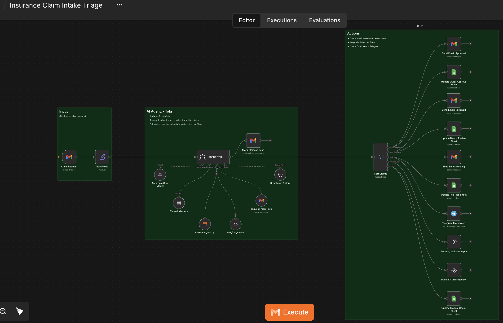
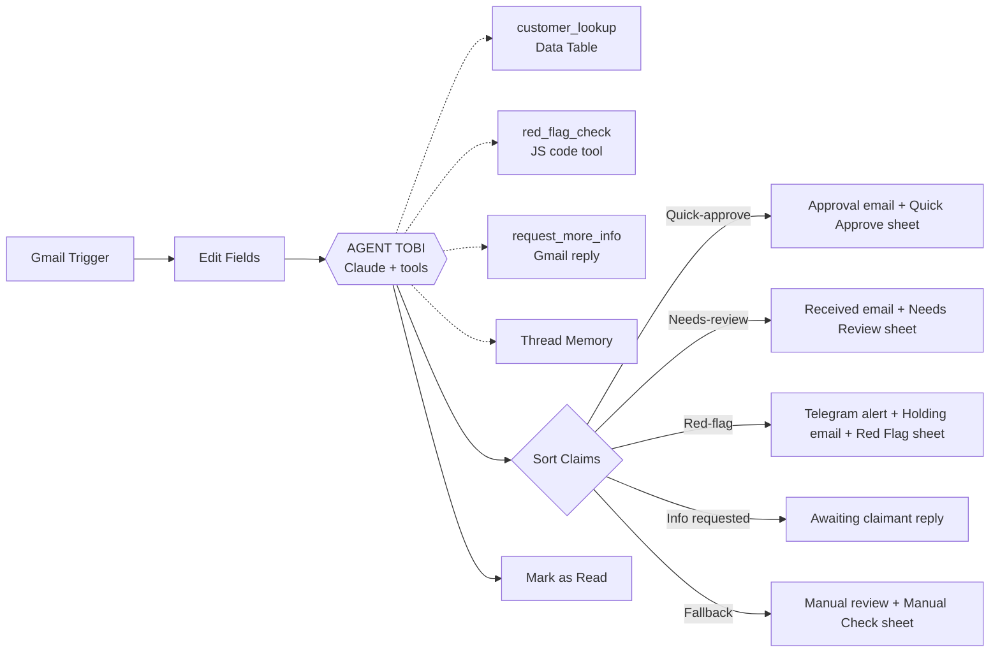

# AI Claims Intake Triage (n8n + Claude)

An n8n automation that reads incoming insurance claim emails, checks them against policy records, scores them for fraud-risk signals, and routes each claim to the right team, with no manual sorting.

> Demo project built with mock data for a fictional insurance company. No real customer data is used.

## The problem

Claims teams spend a lot of time reading every email, looking up the policy, and deciding who should handle it. Simple claims wait behind complex ones, and suspicious claims can slip through unnoticed.

## What this workflow does

1. **Trigger:** Gmail polls the inbox every minute for unread claim emails.
2. **Normalise:** Sender, subject, body, thread ID and message ID are extracted.
3. **AI agent ("Tobi", powered by Claude):**
   - Looks up the claimant's policy in an n8n Data Table (`customer_lookup`).
   - Extracts incident type, date, amount and description from the email.
   - If key details are missing, replies **in the same email thread** asking only for what is missing (`request_more_info`). Thread memory means it uses the claimant's answer when they reply.
   - Runs a rule-based fraud signal check (`red_flag_check`).
   - Returns a structured JSON decision.
4. **Route:** A Switch node sends the claim down one of five paths.
5. **Act:** Emails the claimant, logs the claim to the right Google Sheet tab, and sends a Telegram alert for high-risk claims.

## Architecture

## Claim categories

| Category | When it applies | What happens |
|---|---|---|
| **quick-approve** | Active policy, amount well within coverage, consistent description, no signals | Approval email, logged to *Quick Approve* sheet |
| **needs-review** | Some signals, larger amount, or anything an adjuster should read | "Received" email, logged to *Needs Review* sheet |
| **red-flag** | Strong fraud-risk signals | Telegram alert to the team, neutral holding email, logged to *Red Flag* sheet |
| **info-requested** | Essential detail missing or vague | Agent emails the claimant in the same thread and waits |
| **fallback** | Anything unexpected | Manual review, logged to *Manual Check* sheet |

## Red-flag signals checked

The `red_flag_check` tool is deterministic JavaScript, so the fraud rules are transparent and auditable rather than left to the model alone:

- Claim filed within 30 days of the policy start
- Incident within 14 days of the policy start
- Amount at or above 80% of the coverage limit, or above the limit
- Two or more prior claims on record
- Pressure language ("urgent", "immediately", "cash", "pay me now", etc.)
- High-severity loss type (total loss, theft, write-off)
- Very thin description

The agent weighs these signals together to decide the category.

## Design decisions

- **Rules plus AI, not AI alone.** Fraud signals come from a code tool; the model reasons over them and the email context.
- **Structured output.** A JSON schema forces a valid category and fields, so the Switch node routes reliably.
- **Human in the loop.** The agent never rejects or accuses anyone. Red-flag claims go to a person via Telegram, and the claimant gets a neutral holding message.
- **Thread-aware follow-ups.** Replies stay in the original email thread, with memory keyed on the Gmail thread ID.

## Tech stack

n8n · Claude (Anthropic) · Gmail · Google Sheets · Telegram · n8n Data Tables · JavaScript

## Setup

1. Import `claims-intake-triage.json` in n8n via **Workflows → Import from file**.
2. Reconnect credentials: Gmail, Google Sheets, Telegram and Anthropic.
3. Create an n8n Data Table named `customers` with columns: `email`, `name`, `policy_number`, `policy_type`, `policy_start_date`, `coverage_limit`, `prior_claims`.
4. Create a Google Sheet with tabs **Quick Approve**, **Needs Review**, **Red Flag** and **Manual Check**, each with columns: `Name`, `email`, `Policy Number`, `Claim`, `AI Assessment`.
5. Replace the placeholders in the workflow: `YOUR_GOOGLE_SHEET_ID`, `YOUR_TELEGRAM_CHAT_ID`.
6. Activate the workflow and send a test claim email.

## Test scenarios

| Test email | Expected category |
|---|---|
| Minor claim, long-standing policy, clear description, small amount | quick-approve |
| Larger claim with one signal (for example, a prior claim on record) | needs-review |
| Theft claim filed a week after policy start, amount near the coverage limit, "pay me urgently" | red-flag |
| "I had an accident, please help" (no date, no amount) | info-requested, agent replies asking for the missing details |
| Sender email not in the `customers` table | needs-review, "no policy record found" |

## Possible improvements

- Attachment handling (photos, police reports) with document extraction
- A human approval step before the approval email is sent
- Duplicate-claim detection
- A dashboard on top of the Google Sheet for claim volume by category

## Author

Blessing Emmanuel, Data Analyst moving into AI automation.
[GitHub](https://github.com/blessingaoemmanuel)
